# L08 - GetABoat and World Landmarks Quiz (Styled)

This app contains two apps, each in its own subfolder, restyled with StyleSheets and Flexbox props:
- **BoatsApp** (`BoatsApp/`): GetABoat, a product page that shows the 6 powerboats sold by a local power boat dealer.
- **QuizApp** (`QuizApp/`): World Landmarks Quiz, which shows a photo of a landmark for each question and tells the user how many answers are correct.

`App.js` runs the QuizApp. To run the BoatsApp, comment out the QuizApp lines in `App.js` and uncomment the BoatsApp lines.

# ScreenShots of App BEFORE applying Stylesheet changes

Screenshots:  
BoatsApp:  
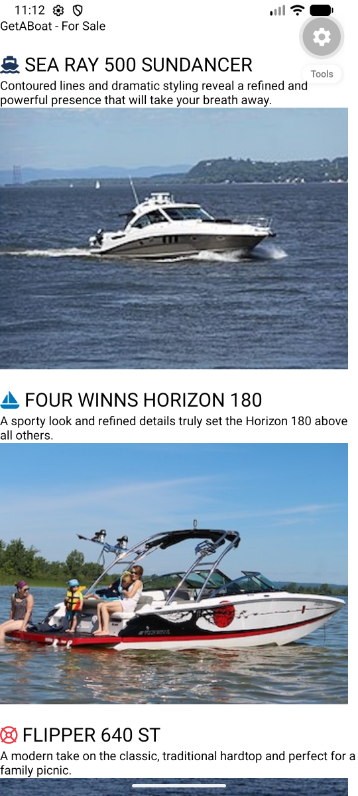
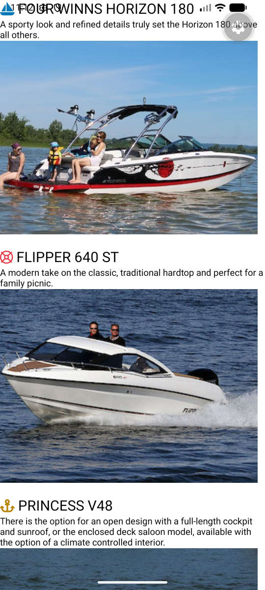
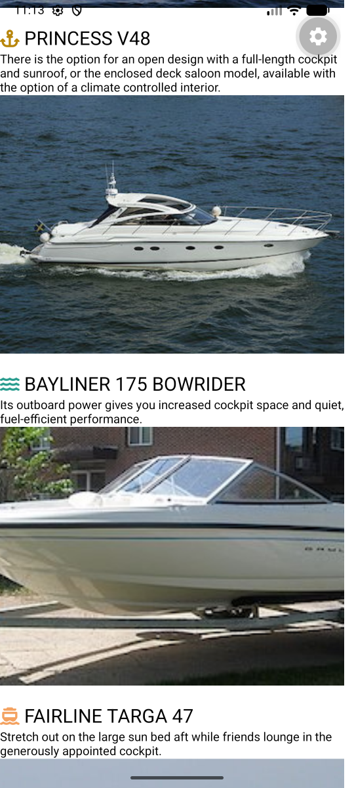
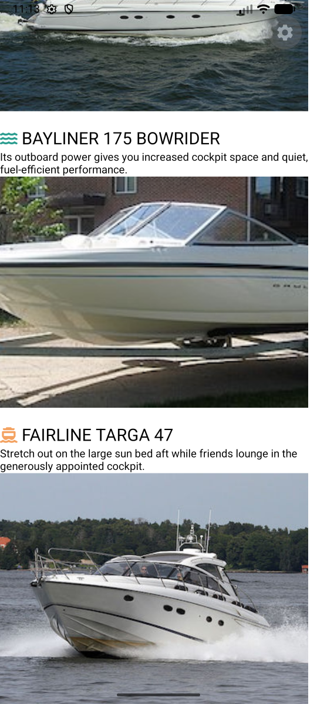

QuizApp:  
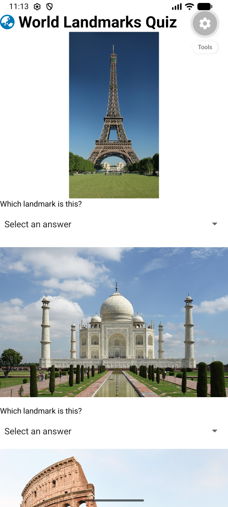
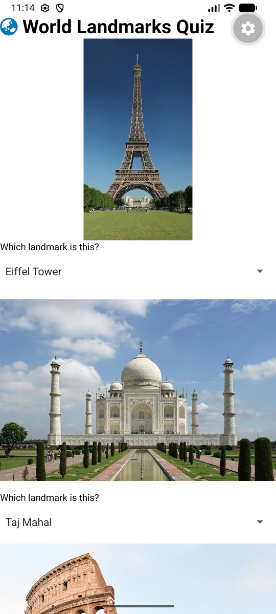
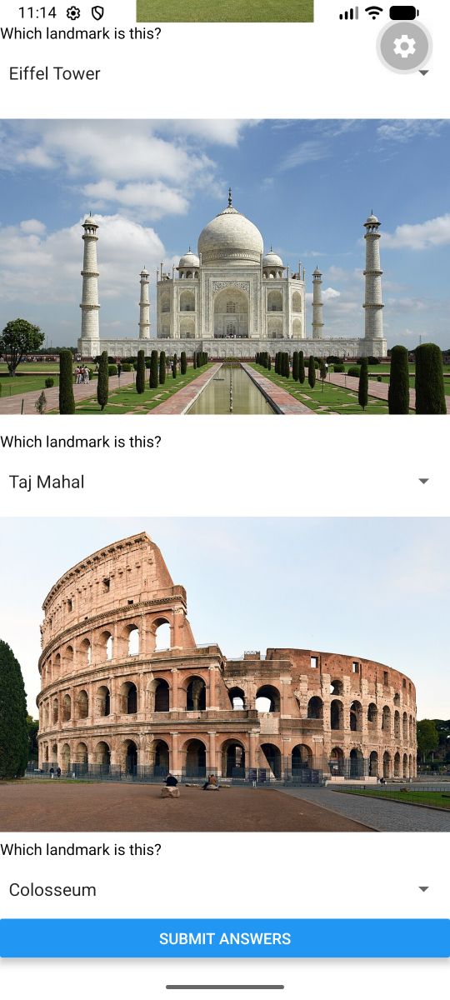
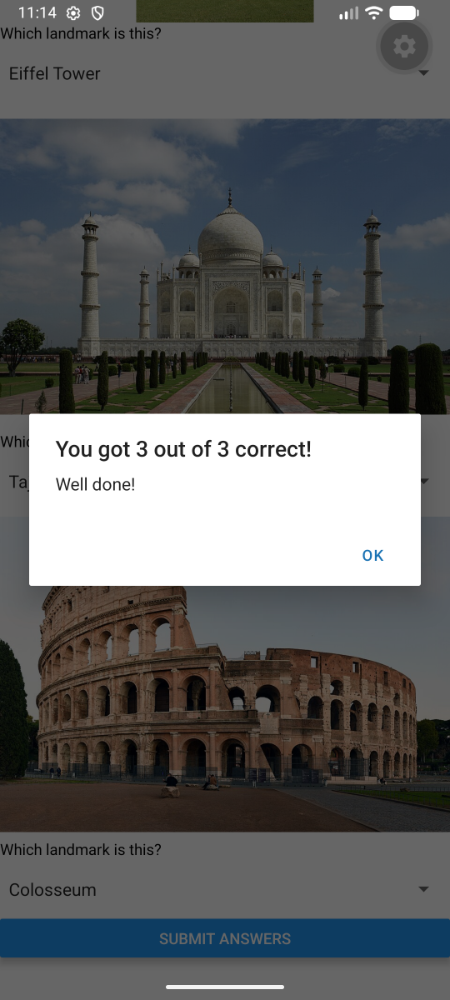

# ScreenShots of App AFTER applying Stylesheet changes

Screenshots:  
BoatsApp:  
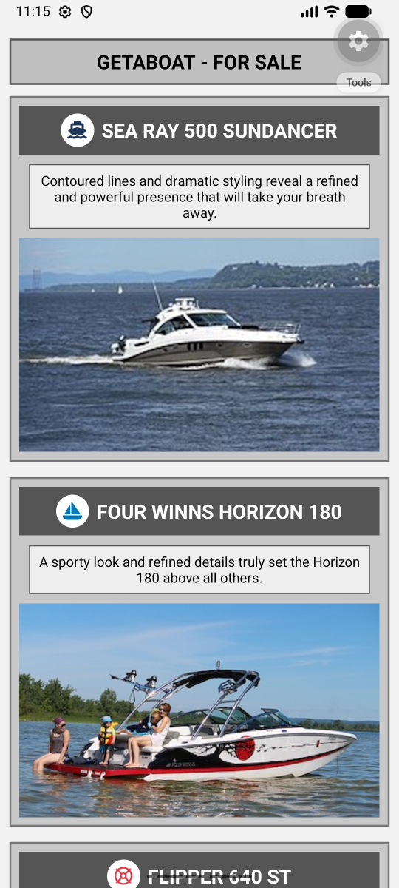
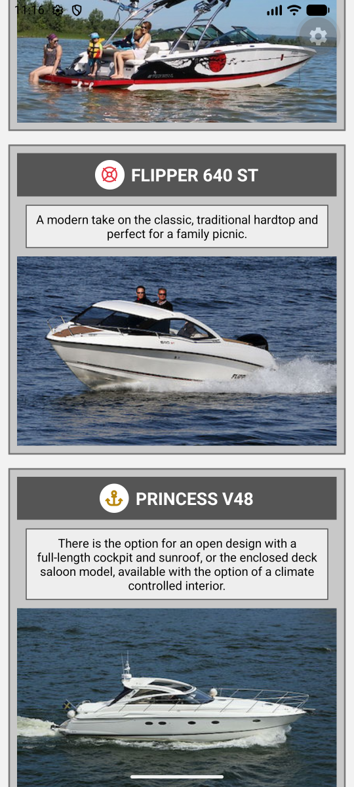
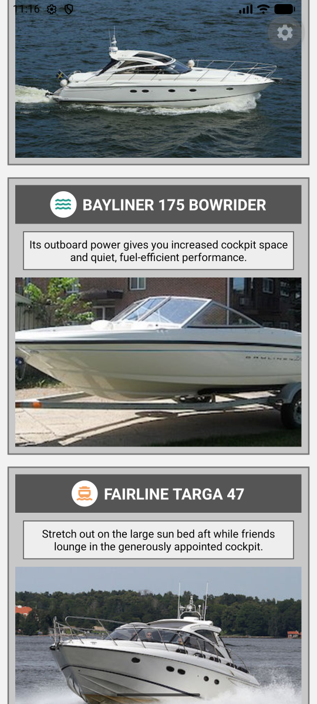

QuizApp:  
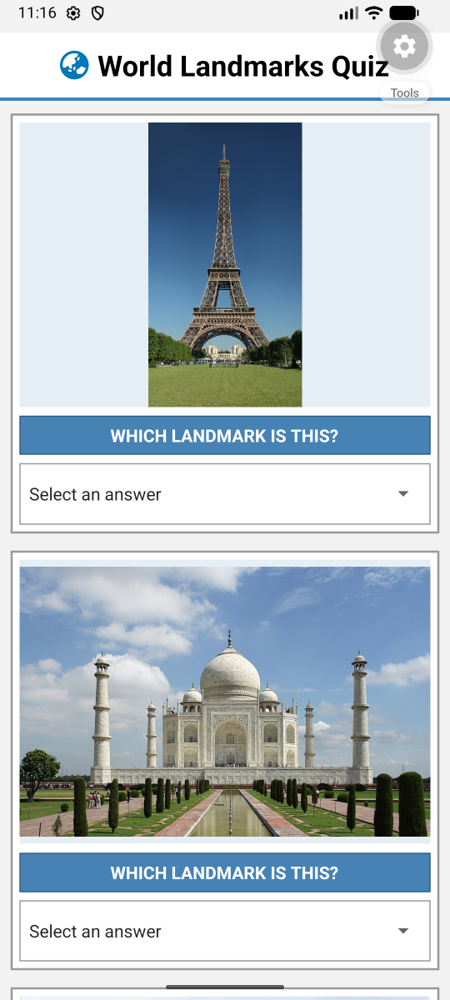
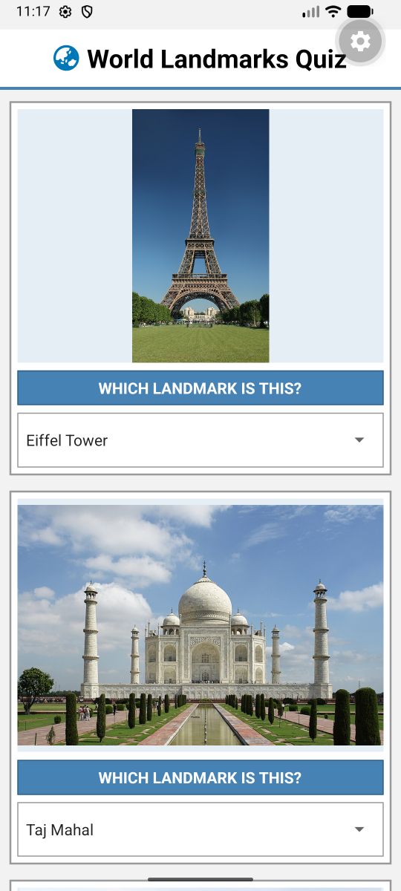
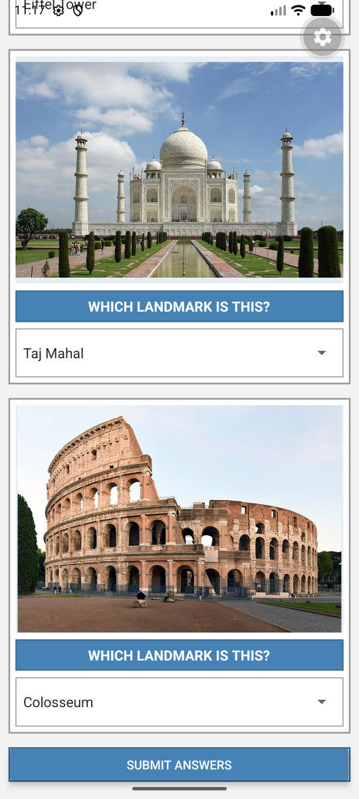
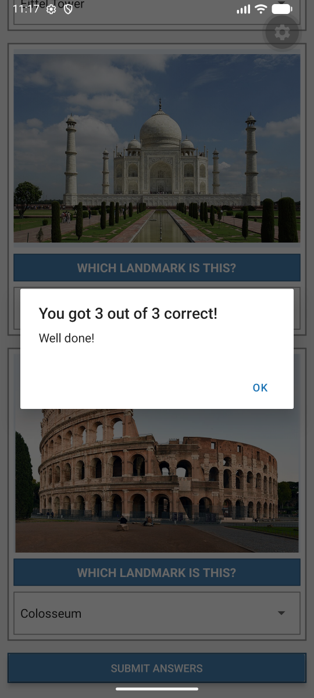

# Link to Demo Video with audible narration explaining styling changes with code reference

Demo Video Link:  
PASTE_VIDEO_LINK_HERE
